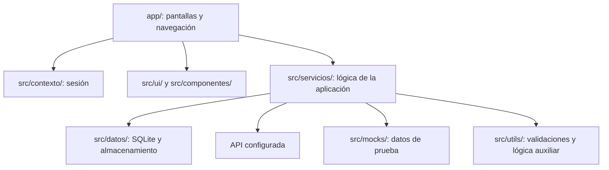

# Arquitectura

La aplicación está organizada en rutas y módulos compartidos. Las pantallas usan los servicios
para acceder a datos, sin conectarse directamente a la API ni a SQLite.

## Módulos

- `app/`: pantallas, layouts y navegación por perfil.
- `src/componentes/` y `src/ui/`: componentes reutilizables.
- `src/contexto/`: estado de sesión compartido.
- `src/servicios/`: autenticación, reportes, sincronización y acceso a datos.
- `src/datos/`: persistencia local, archivos y caché.
- `src/mocks/`: datos y respuestas de prueba cuando no hay una API configurada.
- `src/tipos/`: modelos y contratos usados en la aplicación.
- `src/utils/`: funciones independientes de la interfaz.

## Reportes sin conexión

Los reportes se guardan primero en una cola local de SQLite. Cuando hay conexión, la cola los
envía a través del servicio de reportes. La aplicación conserva una copia local para consultar
los reportes y detectar posibles duplicados sin conexión.
